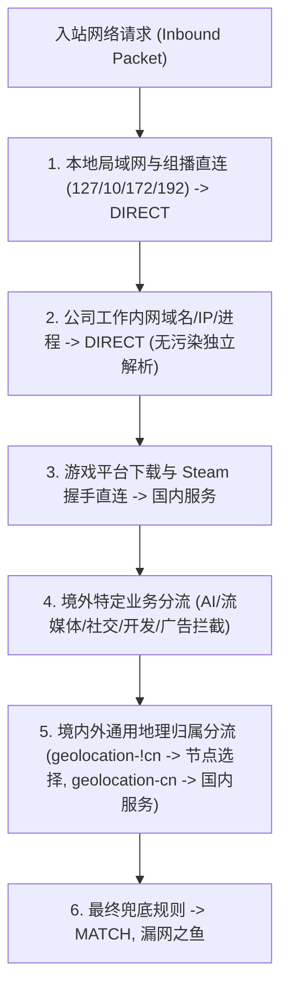

# self-mihomo-override 项目权威技术文档 (PROJECT.md)

> **首席架构师审阅意见 (Linus Torvalds)**
> *"Bad programmers worry about the code. Good programmers worry about data structures and their relationships."*
> 本文档是本项目架构、规则机制、合并语义、多客户端兼容与测试工程的唯一权威依据。
> 最后更新：2026-10-15

---

## 一、 系统架构演进与当前状态

### 1.1 演进历程：从多文件脆弱流水线到 All-in-One 工业级单脚本

- **V1 阶段（旧架构）**：
  - 分立为三个覆写：`1a128f773c5.js`（DNS与前置直连）、`1a128e0523d.js`（节点清洗）、`1b0sb00st01.yaml`（SubBoost分流）。
  - **致命缺陷**：极度依赖客户端特定的全局执行顺序（必须 JS 先清空/初始化 rules，YAML 再通过 `rules+:` 追加）。若顺序颠倒或客户端不支持多覆写有序编排，YAML 规则直接被清空，或订阅自带的数千条规则引发 `proxy not found` 崩溃。同时，工作内网信息硬编码在脚本中，有 Git 泄密风险。
- **V2 / V3 阶段（当前现代架构）**：
  - **三档独立预设并行输出**：由 `scripts/gen_override.py` 自动化并行编译 `minimal` (16组)、`standard` (23组)、`full` (41组) 三套完全独立的 JS 与 YAML 覆写。
  - **职责一体化流水线**：单脚本内部完成「Fake-IP 与独立 Nameserver 注入 → 垃圾与高倍率节点清洗与级联引用维护 → 策略组与规则集装配 → 拓扑保序与引用完整性保障」。
  - **敏感配置安全物理隔离**：个人工作内网信息存放于 `config/private_work.json`（已加入 `.gitignore`），代码库仅公开脱敏模板 `config/private_work.example.json`。
  - **双轨后备保障**：同步输出 `override/customSubBoost.{minimal,standard,full}.yaml`，供纯 YAML 客户端备用。

### 1.2 运行时核心指标

| 评估维度 | Minimal (极简版) | Standard (标准版) | Full (全量版) | 架构处理与保障机制 |
|---|:---:|:---:|:---:|---|
| **策略组总数 (proxy-groups)** | 16 个 | 23 个 | 41 个 | 节点选择、自动选择、手动切换、6 大核心地区、1 个其他国家与业务策略组 |
| **规则集提供者 (rule-providers)** | 12 个 | 24 个 | 94 个 | 默认 `DIRECT` + `fastly.jsdelivr.net` 高可用 CDN，彻底消除冷启动死锁与 EOF 风险 |
| **规则条目 (rules)** | 55 条 | 67 条 | 137 条 | 拓扑保序：私有内网/局域网 -> 工作专有直连 -> 游戏优化 -> 业务分流 -> MATCH 兜底 |
| **节点清洗效率** | 削减 50% ~ 70% | 削减 50% ~ 70% | 削减 50% ~ 70% | 自动过滤流量提示/官网广告节点，剔除 >1.0x 的高倍率节点，并保留 1x 与 IEPL 专线 |
| **内核冷启动测试耗时** | ~15ms | ~22ms | ~35ms | 本地 `mihomo-test.exe -t` 实测，毫秒级通过语法与分流解析 |

---

## 二、 跨客户端与跨平台兼容性设计

### 2.1 支持客户端清单

1. **Clash Party / Sparkle**：
   - 支持多覆写与单覆写。推荐单覆写挂载 `override/customSubBoost.js`（ext: `js`），简化维护成本。
2. **Flclash**：
   - 基于 Flutter 开发的现代跨平台客户端（Windows / macOS / Linux / Android / iOS）。
   - 内置纯 JS 引擎沙箱（基于 QuickJS 或 JavaScriptCore），提供单入口 `function main(config) { return config; }`。
   - `customSubBoost.js` 零外部依赖，直接全文复制到 Flclash 覆写脚本区即可即刻运行。
3. **bettbox (Flclash Fork)**：
   - 继承 Flclash 核心机制，完全通用。

### 2.2 跨平台 ECMAScript 语法约束与空安全

为确保在移动端（Android / iOS）及不同嵌入式 JS 引擎中 100% 稳定运行，`customSubBoost.js` 严格恪守以下规范：

1. **纯标准 ECMAScript 2020**：
   - 严禁使用 Node.js 专属全局对象与模块（如 `process`, `Buffer`, `fs`, `path`, `require`）。
   - 严禁使用浏览器 DOM API（如 `window`, `document`, `fetch`, `XMLHttpRequest`）。
   - 注：脚本末尾的 `if (typeof module !== 'undefined' && module.exports)` 进行了运行环境动态探测，保证在 Node.js 测试沙箱中可被单元测试加载，而在客户端内嵌引擎中不报错。
2. **防御性空安全 (Defensive Null Safety)**：
   - 必须防御订阅源配置残缺或空配置场景：
     ```javascript
     if (!config || typeof config !== 'object') return {};
     config.proxies = Array.isArray(config.proxies) ? config.proxies : [];
     config.rules = Array.isArray(config.rules) ? config.rules : [];
     config['proxy-groups'] = Array.isArray(config['proxy-groups']) ? config['proxy-groups'] : [];
     config['rule-providers'] = (config['rule-providers'] && typeof config['rule-providers'] === 'object') ? config['rule-providers'] : {};
     ```
3. **移动端 PROCESS-NAME 容错处理**：
   - 在 Android / iOS 等移动操作系统或纯 TUN 模式下，内核不保证能够获取进程名，`PROCESS-NAME` 规则会被内核静默跳过。
   - 分流链设计依靠前置的 `IP-CIDR` 与 `DOMAIN-SUFFIX` 规则确保内网与关键流量的绝对直连，即使移动端丢失进程名，分流依然坚如磐石。

---

## 三、 客户端覆写合并底层机制 (app.asar 权威解密)

> 从 `Clash Party/resources/app.asar` 提取解出的底层源码逻辑。

### 3.1 执行逻辑流水线

```
applyOverrides(profile, overrideIds)
  ├─ ext: js   → runOverrideScript(profile, content)
  │              在隔离上下文中执行 main(config)，其返回值【整对象替换】原 profile。
  └─ ext: yaml → deepMerge(profile, patch, isOverride=true)
                 按特定的键名语法进行属性覆盖或数组拼接。
```

### 3.2 deepMerge 数组键名约定

| 键名写法 | 行为语义 | 典型应用 |
|---|---|---|
| `rules+:` | **追加**到已有数组末尾 (append) | YAML 覆写中在直连白名单之后追加 SubBoost 规则 |
| `+rules:` | **前插**到已有数组开头 (prepend) | 将高优先级直连规则插入到最前 |
| `rules!:` | **整体覆盖**现有对象或数组 | 强制重写某个层级的所有内容 |
| `rules:` | **整段替换**（默认行为） | 替换原有规则，丢弃订阅旧规则 |

⚠ **严禁臆造不存在的键名**：如 `prepend-rules`、`append-rules`，在底层代码中完全不存在，会被作为无效未知键直接忽略。

---

## 四、 规则链拓扑保序机制 (Topological Order)

Mihomo Meta 内核对 `rules` 采取 **First-Match-Win (首次命中即停)** 判决机制。规则数组的先后次序直接决定了网络连通性与安全性：



### 关键保序约束与避坑指南

1. **局域网与私有内网绝对置顶**：
   - 必须优先处理 `10.0.0.0/8`, `172.16.0.0/12`, `192.168.0.0/16` 等私网 CIDR，附带 `no-resolve` 标签，禁止 DNS 解析触发额外等待。
2. **Steam 商店代理 vs Steam 下载直连**：
   - `DOMAIN-SUFFIX,store.steampowered.com,Steam` 必须优先于游戏下载直连规则，否则 Steam 商店会被误判为国内直连导致社区页面黑屏。
   - `cm.steampowered.com` 与 `steamserver.net` 必须分流到 `国内服务`（DIRECT），保证 Steam 登录握手时获取到国内 IP，避免账号异地风控。
3. **中国与非中国规则后置**：
   - `RULE-SET,geolocation-!cn,非中国` 与 `RULE-SET,geolocation-cn,国内服务` 必须置于特定业务（如 OpenAI、GitHub 等）之后，防止特定服务的 CDN 节点被泛化地理规则错误截胡。

---

## 五、 生成器与工程化测试体系

### 5.1 数据模型与渲染器完全解耦设计

生成器 (`scripts/gen_override.py`) 彻底消除了过去数据结构与模板硬编码混杂的代码坏味道：

```
[config/rules_profile.json]  --> [build_data_models()] --> 统一数据模型 (groups, providers, rules)
[config/private_work.json]                                     │
                                         ┌─────────────────────┴─────────────────────┐
                                         ▼                                           ▼
                            [build_all_in_one_js()]                     [build_yaml()]
                                         ▼                                           ▼
                           override/customSubBoost.{tier}.js          override/customSubBoost.{tier}.yaml
```

### 5.2 自动化质量门禁 (CI Verification Pipeline)

在任何代码修改后，必须执行以下自动化核查体系，全部通过方可交付：

1. **Node.js 运行时全量断言 (`scripts/test_js_override.py`)**：
   - 在真实 Node.js 沙箱中调用 3 大预设档位的 `main(config)`。
   - 验证 10 项核心断言（3 档 × 10 = 30 项测试）：垃圾节点过滤、高倍率排除、IEPL 专线保留、策略组数量、规则集数量、级联死链清理、DNS Fake-IP 注入、拓扑保序、空配置防御、**外键规则引用完整性断言**。
2. **策略组有向图拓扑分析 (`scripts/nest_check.py`)**：
   - 采用 DFS 三色标记法对 3 大档位策略组有向图进行环检测与深度遍历。
   - 确保 **0 闭环**，且全局最大嵌套深度严格 **<= 1**（远低于客户端卡顿阈值 3）。
3. **真实多订阅内核合法性验证 (`scripts/verify.py`)**：
   - 自动扫描本地真实机场订阅底稿（`profiles/`），无本地订阅时自动注入内建标准 Mock 节点兜底。
   - 分别在 JS 与 YAML 双模式下拼装沙箱，调用本地真实 `mihomo-test.exe -t` 内核，确认 0 错误、0 警告。
4. **图标与规则集资源探测 (`scripts/check_icons.py`, `scripts/check_urls.py`)**：
   - 确保 Qure 图标 100% 存在且命中，94 个 MRS 规则集在 CDN 上连通可用。
